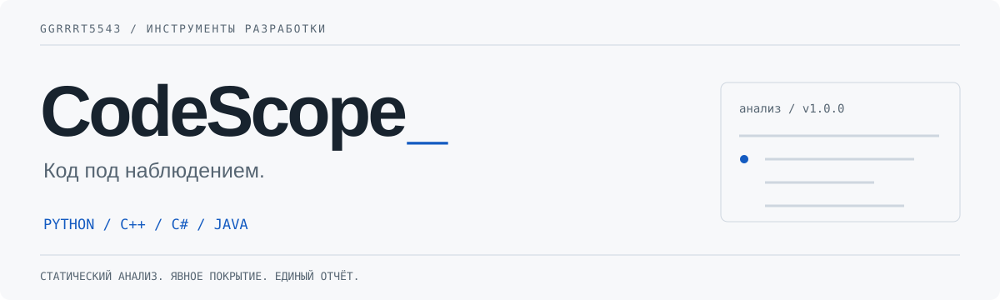

<picture>
  <source media="(prefers-color-scheme: dark)" srcset="assets/cover-dark.svg">
  
</picture>

<p align="center">
  <a href="https://github.com/ggrrrt5543/codescope/actions/workflows/ci.yml"></a>
  <a href="https://github.com/ggrrrt5543/codescope/releases/latest"></a>
  
  <a href="LICENSE"></a>
</p>

<p align="center"><a href="#быстрый-старт">Установка</a> · <a href="#что-проверяется">Возможности</a> · <a href="https://ggrrrt5543.github.io/ggrrrt5543/codescope/">Демо</a> · <a href="https://github.com/ggrrrt5543/codescope/releases/latest">Релиз</a> · <a href="SECURITY.md">Безопасность</a></p>

**Вставь код. Найди проблему. Разберись в причине.**

CodeScope — локальное веб-приложение для статической проверки **Python, C++, C# и Java**. Показывает ошибки по строкам, объяснения и единый отчёт вместо разрозненного вывода инструментов. Без аккаунта и без AI API.

> **v1.0.0 не доказывает правильность программы.** Анализаторы находят определённые классы проблем, а логику задачи проверяют тесты и человек. Приложение не запускает пользовательские программы. Java/C# компиляция может создавать временные файлы, которые никогда не исполняются.

## Интерфейс


- Редактор с номерами строк, маркерами проблем и переходом к нужной строке.
- До 12 файлов одного языка за проверку; 256 КБ / 6000 строк на файл, 1 МБ суммарно.
- Единый отчёт: **файл → строка → уровень → инструмент → проблема → пояснение**.
- Фильтры ошибок и замечаний; JSON и автономный HTML-отчёт без полных исходников.
- Светлая/тёмная тема, адаптивный интерфейс, клавиатурный запуск `Ctrl/⌘ + Enter`.
- Статусы инструментов: выполнен / не установлен / сбой / тайм-аут. **Неполная проверка обозначается явно.**

## Быстрый старт

Нужен **Python 3.10+**. Для предсказуемой работы Pyright установи **Node.js 20+** заранее. Компиляторы подключаются отдельно; отсутствие компилятора не блокирует синтаксический разбор.

```sh
git clone https://github.com/ggrrrt5543/codescope.git
cd codescope
python -m venv .venv
```

Активируй окружение:

```powershell
# Windows PowerShell
.venv\Scripts\Activate.ps1
```

```sh
# Linux / macOS
. .venv/bin/activate
```

Установи протестированный набор зависимостей и запусти приложение:

```sh
python -m pip install -r requirements-lock.txt
python -m pip install --no-deps .
codescope serve
```

Открой **http://127.0.0.1:8765**. Для другого порта: `codescope serve --port 9000`.

В ZIP-релизе есть `run.bat` и `run.sh`: они создают окружение, устанавливают зависимости и запускают приложение. Первый запуск требует интернет и Python; **это не готовый EXE**. Команда для Linux/macOS: `sh run.sh`.

### Полный набор инструментов

| Язык | В Python-установке | Дополнительно для более глубокой проверки |
|---|---|---|
| Python | AST, Ruff, Bandit, Pyright | Node.js 20+ для Pyright |
| C++ | Tree-sitter: синтаксис | G++ с поддержкой C++17 и Cppcheck |
| C# | Tree-sitter: синтаксис | **.NET SDK 8** — не только Runtime |
| Java | Tree-sitter: синтаксис | **JDK 17+** с `javac` — не только JRE |

Добавь инструменты в `PATH`, перезапусти приложение и открой «Покрытие проверки». Проверка окружения: http://127.0.0.1:8765/api/health.

Пример для Ubuntu/Debian: `sudo apt-get install g++ cppcheck openjdk-17-jdk-headless`. .NET SDK установи по [официальной инструкции](https://learn.microsoft.com/dotnet/core/install/). На Windows G++ можно установить через MSYS2, а Cppcheck — с [сайта проекта](https://cppcheck.sourceforge.io/). Версия C++ в v1.0.0 фиксирована на C++17; C# — .NET 8.

### Docker: все четыре языка

```sh
docker build -t codescope:1.0.0 .
docker run --rm -p 127.0.0.1:8765:8765 \
  --memory 2g --cpus 2 --pids-limit 128 --cap-drop ALL \
  --security-opt no-new-privileges --read-only \
  --tmpfs /tmp:rw,nosuid,nodev,size=512m codescope:1.0.0
```

В образ входят G++, Cppcheck, JDK 17 и .NET SDK 8. Сборка скачивает SDK и пакеты. Это **не готовый облачный сервис и не гарантированная песочница**; для недоверенного кода нужна отдельная изоляция и запрет исходящей сети. Не монтируй личные каталоги. Подробнее: [SECURITY.md](SECURITY.md).

## Что проверяется

| Инструмент | Что он делает | Чего не гарантирует |
|---|---|---|
| Python AST / Tree-sitter | Разбор синтаксиса, позиции проблем | Типы и правильность алгоритма |
| Ruff | Необъявленные имена, неиспользуемый код, часть типичных ошибок | Полный поиск ошибок времени выполнения |
| Bandit | Потенциально опасные Python-конструкции | Аудит безопасности всего проекта |
| Pyright | Несовместимые типы, часть ошибок вызовов | Корректность динамического кода во всех случаях |
| G++ / Cppcheck | Ошибки C++17 и статические предупреждения | Поведение программы на всех входах |
| Roslyn / .NET 8 | Ошибки C# в генерируемом проекте | Сборку произвольного `.sln` или NuGet-зависимостей |
| javac | Ошибки Java, предупреждения компилятора | Сборку Maven/Gradle-проектов и их зависимостей |

**Пример:** `age = input(...)`, затем `age + 5` — Pyright может обнаружить несовместимость строки и числа. Если вместо сложения по заданию нужно умножение, без тестов или спецификации анализатор этого не узнает.

Диагностика внешних инструментов сохраняет исходный язык, обычно английский. Общие пояснения интерфейса — на русском. Разные инструменты могут независимо сообщить об одной проблеме: источник всегда указан.

## Командная строка и API

```sh
codescope check --language python examples/main.py > report.json
codescope check --language cpp examples/main.cpp > report.json
codescope check --language csharp examples/Example.cs > report.json
codescope check --language java examples/Main.java > report.json
```

Коды завершения: `0` — все инструменты отработали, ошибок уровня error нет (замечания возможны); `1` — обнаружены ошибки; `2` — неполное покрытие или проблема входных данных/анализа. `0` не означает доказанную правильность.

```sh
curl http://127.0.0.1:8765/api/analyze \
  -H 'Content-Type: application/json' \
  -d '{"language":"python","files":[{"name":"main.py","content":"print(missing_name)"}]}'
```

Поля результата: `findings`, `tools`, `summary`, `coverage`, `truncated`, `duration_ms`, `version`. `coverage=completed` означает завершение настроенных инструментов, а не «проверено абсолютно всё». Схема маршрутов: `codescope/app.py`.

## Демо и приватность

[GitHub Pages](https://ggrrrt5543.github.io/ggrrrt5543/codescope/) показывает интерфейс и **заранее подготовленные отчёты только для встроенных примеров**. Изменённый код там не анализируется. Для своего кода установи локальную версию.

Исходники передаются только локальному серверу; не сохраняются в браузере и не отправляются AI-провайдерам. Сохраняется лишь тема интерфейса. Сообщения анализаторов могут цитировать фрагменты кода — проверь отчёт перед публикацией. Временные рабочие папки удаляются после проверки; кэши SDK могут сохраняться.

## Ограничения v1.0.0

- Один язык и плоский набор файлов за запрос. Нет ZIP, каталогов, `.csproj`, `.sln`, Maven/Gradle/CMake и установки зависимостей пользовательских проектов.
- Нет запуска программ, поведенческих тестов, AI-рецензирования и автоматического исправления.
- Не заменяет IDE, CI, ручное ревью и аудит безопасности.
- Максимум 400 находок; усечённый отчёт помечается явно. До 18 секунд на инструмент и 85 секунд на запрос.
- Без настроенных компиляторов C++/C#/Java проверяются только частично.
- CLI работает через тот же ограниченный worker. На Windows управление деревом процессов слабее, чем на POSIX; ограничения описаны в SECURITY.md.
- Не публикуй локальный API в интернет: в нём нет авторизации.

## Разработка

```sh
python -m pip install -e '.[dev]'
python -m pytest -q
ruff check codescope tests
```

[Архитектура](docs/architecture.md) · [Участие](CONTRIBUTING.md) · [История версий](CHANGELOG.md)

CI проверяет Python 3.10/3.13, реальные ошибки четырёх языков, ограничения API и браузерный сценарий. Релиз создаётся workflow только после успешных проверок. Dockerfile доступен отдельно; локальная проверка без Docker не является тестом контейнерной сборки.

## Дальше

- Импорт структуры проекта с явным выбором доверия.
- SARIF и интеграция в GitHub Actions.
- Расширение набора языков и объяснений для конкретных правил.
- Изолированный запуск тестов — отдельный режим, не часть v1.0.0.

**Maintained by [ggrrrt5543](https://github.com/ggrrrt5543).** Код CodeScope — MIT; сторонние анализаторы распространяются по собственным лицензиям. Конкретные рекомендации по исправлению всегда требуют проверки.
